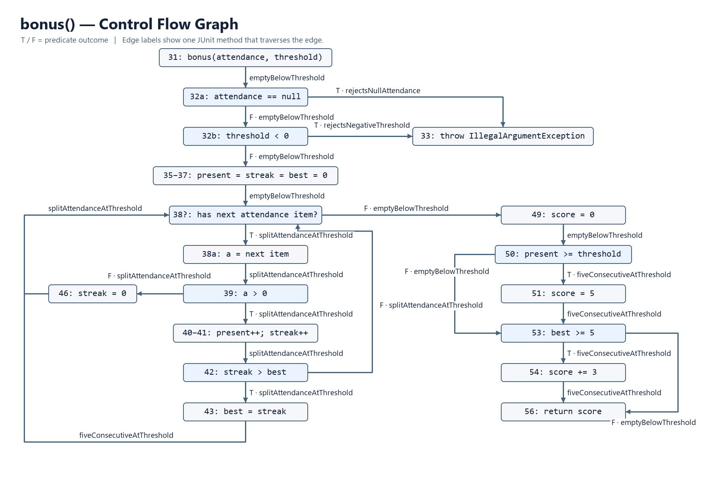

# Лаборатори 10 — Өгөгдлийн урсгалын тест

- Нэр: А. Наранзул
- Оюутны код: B222270823

## Ажлын орчин

~~~text
java -version
java version "17.0.12" 2024-07-16 LTS
Java(TM) SE Runtime Environment (build 17.0.12+8-LTS-286)
Java HotSpot(TM) 64-Bit Server VM (build 17.0.12+8-LTS-286, mixed mode, sharing)
~~~

~~~text
mvn -version
Apache Maven 3.10.0 (c43a36b8d67be7e0805a411bc0898af1a51f5472)
Maven home: C:\Users\Dell G15\Desktop\Shutis\juniorYear\ProgrammingQuality\Lab001\.tools\apache-maven-3.10.0
Java version: 17.0.12, vendor: Oracle Corporation, runtime: C:\Program Files\Java\jdk-17
Default locale: en_US, platform encoding: Cp1252, time zone: Asia/Ulaanbaatar
OS name: "windows 11", version: "10.0", arch: "amd64", family: "windows"
~~~

## A — gcd

13-р мөрөнд x, y тодорхойлогдоно. 15-р мөрөнд y нөхцөлд (p-use), 16-р мөрөнд x ба y тооцоонд (c-use) орж tmp тодорхойлогдоно. 17-р мөрөнд y-г уншиж x-д, 18-р мөрөнд tmp-г уншиж y-д онооно. 20-р мөрөнд x-ийг буцаана.

Хүснэгтэд T/F нь нөхцөлийн үнэн/худал ирмэгийг заана. Зам p-use дээр төгссөн бол T/F нь тухайн салааг дайрсныг илэрхийлнэ. Нэг мөрөнд унших, оноох үйлдэл хоёулаа байвал утгыг эхэлж уншина.

- G1 — zeroDivisor буюу gcd(7, 0) = 7. Давталтгүй замаар x-ийн анхны утгыг буцааж, y-ийн анхны тодорхойлолтыг 15F-д хүргэнэ. Энэ хоёр хосыг зөвхөн G1 хамарна.
- G2 — twoIterations буюу gcd(12, 8) = 4. Давталтын эхэнд (x, y) нь (12, 8), дараа нь (8, 4), гарахад (4, 0) болно. Хоёр давталт нь 17, 18-р мөрийн утгыг дараагийн давталтын use-д хүргэнэ.

| Хувьсагч | Def | Use | Төрөл | Def-clear зам | Тест | Хамарсан |
|---|---:|---|---|---|---|---|
| x | 13 | 16 | c-use | 13 → 15T → 16 | G2 | Тийм |
| x | 13 | 20 | c-use | 13 → 15F → 20 | G1 | Тийм |
| x | 17 | 16 | c-use | 17 → 18 → 15T → 16 | G2 | Тийм |
| x | 17 | 20 | c-use | 17 → 18 → 15F → 20 | G2 | Тийм |
| y | 13 | 15T | p-use | 13 → 15T | G2 | Тийм |
| y | 13 | 15F | p-use | 13 → 15F | G1 | Тийм |
| y | 13 | 16 | c-use | 13 → 15T → 16 | G2 | Тийм |
| y | 13 | 17 | c-use | 13 → 15T → 16 → 17 | G2 | Тийм |
| y | 18 | 15T | p-use | 18 → 15T | G2 | Тийм |
| y | 18 | 15F | p-use | 18 → 15F | G2 | Тийм |
| y | 18 | 16 | c-use | 18 → 15T → 16 | G2 | Тийм |
| y | 18 | 17 | c-use | 18 → 15T → 16 → 17 | G2 | Тийм |
| tmp | 16 | 18 | c-use | 16 → 17 → 18 | G2 | Тийм |

## B — bonus

### Def ба use

| Мөр | Def | c-use | p-use |
|---|---|---|---|
| 31 | attendance, threshold | | |
| 32a | | | attendance == null |
| 32b | | | threshold < 0 (32aF үед) |
| 33 | | | |
| 35 | present | | |
| 36 | streak | | |
| 37 | best | | |
| 38? | | | attendance-д дараагийн элемент байгаа эсэх |
| 38a | a (дараагийн элемент) | | |
| 39 | | | a > 0 |
| 40 | present | present | |
| 41 | streak | streak | |
| 42 | | | streak > best |
| 43 | best | streak | |
| 46 | streak | | |
| 49 | score | | |
| 50 | | | present >= threshold |
| 51 | score | | |
| 53 | | | best >= 5 |
| 54 | score | score | |
| 56 | | score | |

### Тестүүд

| ID | Метод | Оролт (attendance, threshold) | Үр дүн |
|---|---|---|---|
| B1 | emptyBelowThreshold | [], 1 | 0 |
| B2 | splitAttendanceAtThreshold | [1, 0, 1], 2 | 5 |
| B3 | fiveConsecutiveAtThreshold | [1, 1, 1, 1, 1], 5 | 8 |
| B4 | rejectsNullAttendance | null, -1 | IllegalArgumentException |
| B5 | rejectsNegativeThreshold | [1], -1 | IllegalArgumentException |
| B6 | emptyAtZeroThreshold | [], 0 | 5 |
| B7 | longStreakBelowThreshold | [1, 0, 1, 1, 1, 1, 1], 7 | 3 |
| B8 | separatedDaysDoNotMakeFiveDayStreak | [1, 0, 1, 1, 1, 1], 5 | 5 |

### DU хосууд

38T/38F нь for-each-ийн нөхцөл, 38a нь a-д дараагийн элементийг оноох үйлдэл. Хүснэгтийн замуудад үсрэх ирмэгүүдийг мөрөөр нь тэмдэглэв.

| Хувьсагч | Def | Use | Төрөл | Def-clear зам | Тест | Хамарсан |
|---|---:|---|---|---|---|---|
| attendance | 31 | 32aT | p-use | 31 → 32aT | B4 | Тийм |
| attendance | 31 | 32aF | p-use | 31 → 32aF | B1 | Тийм |
| attendance | 31 | 38T | p-use | 31 → 32aF → 32bF → 35 → 36 → 37 → 38T | B2 | Тийм |
| attendance | 31 | 38F | p-use | 31 → 32aF → 32bF → 35 → 36 → 37 → 38F | B1 | Тийм |
| threshold | 31 | 32bT | p-use | 31 → 32aF → 32bT | B5 | Тийм |
| threshold | 31 | 32bF | p-use | 31 → 32aF → 32bF | B1 | Тийм |
| threshold | 31 | 50T | p-use | 31 → 32aF → 32bF → 35 → 36 → 37 → 38F → 49 → 50T | B6 | Тийм |
| threshold | 31 | 50F | p-use | 31 → 32aF → 32bF → 35 → 36 → 37 → 38F → 49 → 50F | B1 | Тийм |
| a | 38a | 39T | p-use | 38a → 39T | B2 | Тийм |
| a | 38a | 39F | p-use | 38a → 39F | B2 | Тийм |
| present | 35 | 40 | c-use | 35 → 36 → 37 → 38T → 38a → 39T → 40 | B2 | Тийм |
| present | 35 | 50T | p-use | 35 → 36 → 37 → 38F → 49 → 50T | B6 | Тийм |
| present | 35 | 50F | p-use | 35 → 36 → 37 → 38F → 49 → 50F | B1 | Тийм |
| present | 40 | 40 | c-use | 40 → 41 → 42T → 43 → 38T → 38a → 39T → 40 | B3 | Тийм |
| present | 40 | 50T | p-use | 40 → 41 → 42T → 43 → 38F → 49 → 50T | B3 | Тийм |
| present | 40 | 50F | p-use | 40 → 41 → 42T → 43 → 38F → 49 → 50F | B7 | Тийм |
| streak | 36 | 41 | c-use | 36 → 37 → 38T → 38a → 39T → 40 → 41 | B2 | Тийм |
| streak | 41 | 41 | c-use | 41 → 42T → 43 → 38T → 38a → 39T → 40 → 41 | B3 | Тийм |
| streak | 41 | 42T | p-use | 41 → 42T | B2 | Тийм |
| streak | 41 | 42F | p-use | 41 → 42F | B2 | Тийм |
| streak | 41 | 43 | c-use | 41 → 42T → 43 | B2 | Тийм |
| streak | 46 | 41 | c-use | 46 → 38T → 38a → 39T → 40 → 41 | B2 | Тийм |
| best | 37 | 42T | p-use | 37 → 38T → 38a → 39T → 40 → 41 → 42T | B2 | Тийм |
| best | 37 | 42F | p-use | 37 → 38T → 38a → 39T → 40 → 41 → 42F | — | Биелэхгүй |
| best | 37 | 53T | p-use | 37 → 38F → 49 → 50F → 53T | — | Биелэхгүй |
| best | 37 | 53F | p-use | 37 → 38F → 49 → 50F → 53F | B1 | Тийм |
| best | 43 | 42T | p-use | 43 → 38T → 38a → 39T → 40 → 41 → 42T | B3 | Тийм |
| best | 43 | 42F | p-use | 43 → 38T → 38a → 39F → 46 → 38T → 38a → 39T → 40 → 41 → 42F | B2 | Тийм |
| best | 43 | 53T | p-use | 43 → 38F → 49 → 50T → 51 → 53T | B3 | Тийм |
| best | 43 | 53F | p-use | 43 → 38T → 38a → 39F → 46 → 38T → 38a → 39T → 40 → 41 → 42F → 38F → 49 → 50T → 51 → 53F | B2 | Тийм |
| score | 49 | 54 | c-use | 49 → 50F → 53T → 54 | B7 | Тийм |
| score | 49 | 56 | c-use | 49 → 50F → 53F → 56 | B1 | Тийм |
| score | 51 | 54 | c-use | 51 → 53T → 54 | B3 | Тийм |
| score | 51 | 56 | c-use | 51 → 53F → 56 | B2 | Тийм |
| score | 54 | 56 | c-use | 54 → 56 | B3 | Тийм |

- 46-р мөрийн reset нь өмнө нь хүчинтэй байсан streak-ийн 36, 41 эсвэл өмнөх давталтын 46-р мөрийн def-ийг дарна (kill). 36→41, 41→41, 46→41 замд 46 дахин таарвал өмнөх утга 41-ийн use-д хүрэхгүй.
- streak-ийн 36→42T, 36→42F, 36→43 болон 46→42T, 46→42F, 46→43 хослолд 41-р мөр заавал дахин оноодог тул def-clear зам байхгүй. a-ийн 38a→39 хос давталт дамнахгүй. Дараагийн 39 хүрэхээс өмнө 38a дахин онооно.
- 49→54, 49→56 хосын замд 51 дайрвал score-ийн 49-р мөрийн утга дарагдана. 56-д 49 эсвэл 51-ийн утгыг хүргэхийн тулд мөн 54-ийг алгасана. 54→54 зам байхгүй. Энэ мөрөнд өмнөх score-ийг эхэлж уншаад, шинэ утга оноосны дараа шууд 56 руу орно.
- best 37→42F биелэхгүй. best 0 хэвээр байх үеийн анхны ирсэн өдөр streak 1 болж, 42T-ээр орно.
- best 37→53T биелэхгүй. 37-ын утга өөрчлөгдөөгүй бол best 0 тул 5 хүрэхгүй.
- attendance null үед 32aT дээр богино холболт хийгдэж, 32b үнэлэгдэхгүй. Сөрөг threshold-той оролт 33 дээр тасардаг тул 50-д хүрэхгүй. 33-аас давталт болон оноо тооцох хэсэг рүү зам байхгүй.

### All-defs ба хамралт

All-defs-д bonus-ийн B3, B7 гэсэн хоёр тест хангалттай. B3-д 51-р мөрөөс оноосон 5-ыг 54 дээр уншиж, шинэ 8-ыг 56-д буцаана. B7-д 50F салаагаар 51-ийг алгасаж, 49-р мөрийн 0-ийг 54 дээр уншаад 3-ыг 56-д буцаана. 49-ийн утгыг ашиглахад 51 гүйцэтгэгдэх ёсгүй. 51-ийн утгыг ашиглахад 51 гүйцэтгэгдэх ёстой. Нэг дуудлага 50-ын хоёр салааг зэрэг дайрах боломжгүй тул дор хаяж хоёр дуудлага хэрэгтэй.

B3 дээр attendance ба threshold-ийг шалгаж, 38a-ийн утгыг 39-д уншина. Эхний ирэлтээр present-ийн 35, streak-ийн 36, best-ийн 37-р мөрийн утгуудыг 40, 41, 42-р мөрөнд ашиглана. Дараагийн ирэлт нь 40, 41, 43-аар шинэчлэгдсэн утгуудыг 40, 41, 42-д уншина. B7 тасалсны дараах ирэлтээр 46-р мөрийн streak-ийг 41-д ашиглана.

| Үе | Tests run | Branch covered / нийт | Line covered / нийт | JaCoCo CSV |
|---|---:|---:|---:|---|
| All-defs | 4 | 13/16 | 22/24 | [jacoco-alldefs.csv](results/jacoco-alldefs.csv) |
| Эцсийн | 10 | 16/16 | 23/24 | [jacoco-final.csv](results/jacoco-final.csv) |

All-defs дээр 32aT, 32bT, 53F салааг дайраагүй. B1–B5 болон gcd-ийн хоёр тестээр түр шалгахад Branch 16/16 болсон. Гэхдээ 35→50T хос дутуу байв. 50T салааг B2, B3 дээр дайрахад present аль хэдийн 40-р мөрөөр шинэчлэгдсэн байсан. B6 дээр давталт 0 удаа ажиллаж, 35-ын утга 50T-д хүрдэг. B7 нь 40→50F болон 49→54 хосыг хамарна. Эцсийн тайлангийн хамрагдаагүй 7-р мөр нь Java-гийн далд constructor.

## C — Мутацийн туршилт

| Мутаци | Tests run | Унасан тест ба гаралт |
|---|---:|---|
| M1 — streak-ийн нэмэгдлийг устгасан | 9 | BonusTest.fiveConsecutiveAtThreshold:21 expected: &lt;8&gt; but was: &lt;5&gt; BonusTest.longStreakBelowThreshold:41 expected: &lt;3&gt; but was: &lt;0&gt; |
| M2 — best = present | 9 | 0 failure |
| M2 + B8 | 10 | BonusTest.separatedDaysDoNotMakeFiveDayStreak:46 expected: &lt;5&gt; but was: &lt;8&gt; |
| M3 — ашиглагдахгүй total | 10 | 0 failure |

M1-д streak өсөхгүй тул best 5 хүрэхгүй. Урт цуваатай хоёр тест дээр 3 оноо алга болсон.

M2 анхны тестүүдийг давсан. B3 тасралтгүй ирцтэй тул best шинэчлэгдэх бүрд present, streak хоёр ижил. B7 дээр M2 шинэ best-ийг зарим давталтад ихэсгэсэн ч эцэст нь аль аль кодод best 5 хүрч, score 3 хэвээр үлдэнэ. B2 дээр таслалтаас өмнө best = 1 болж, дараагийн ирэлт streak = 1 тул best дахин шинэчлэгдэхгүй. B8 дээр сүүлчийн ирэлтээр present = 5, streak = 4 бөгөөд best шинэчлэгдэнэ. Зөв код 5 оноо өгнө. M2 best-д 5 оноож, урамшууллын 3 оноог нэмж 8 болгосон.

M3 дээр total-д утга оноогоод цааш уншаагүй тул буцаах score өөрчлөгдөөгүй. javac -Xlint:all анхааруулга өгөөгүй. VS Code-ийн Java өргөтгөлд багтсан Eclipse JDT компиляторыг unusedLocal шалгалттай ажиллуулахад дараах анхааруулга гарсан.

~~~text
The value of the local variable total is not used
~~~

Мутаци бүрийн дараа src/main-ийг git restore-оор буцаасан. Эцсийн mvn verify амжилттай, starter commit-тэй харьцуулсан src/main-ийн diff хоосон.

## Дүгнэлт

Branch хамралт нөхцөлийн үнэн ба худал салаа гүйцэтгэсэн эсэхийг харуулдаг. DU анализ тухайн салаанд хувьсагчийн аль оноолтоос утга ирснийг шалгадаг. 50T салаа хамрагдсан байхад present-ийн 35-р мөрийн утгыг тэр салаанд хүргэх тест дутуу байв. For-each давталт доторх streak, best-ийн оноолтыг зам бүрээр дагаж, kill болон биелэхгүй хосыг ялгахад хамгийн их ажил орсон. M2 бүх DU хосыг хамарсан тестүүдийг давсан ч present, streak хоёр зөрөх оролт алдааг илрүүлсэн. M3-д үр дүн өөрчлөгдөөгүй учраас ашиглагдаагүй хувьсагчийг статик шалгалтаар илрүүлсэн.

AI ашиглалт — Codex-оор DU замуудыг гаргаж шалгах, тест бичих, CFG зурах, мутацийн туршилт ажиллуулах, тайланг эмхлэхэд туслуулсан.
